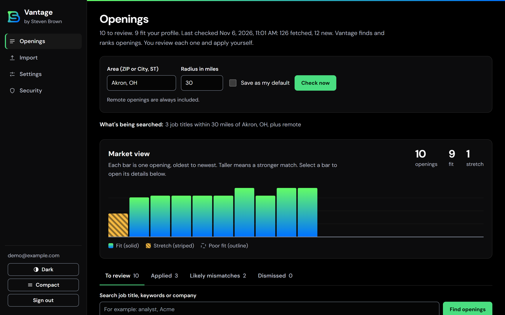
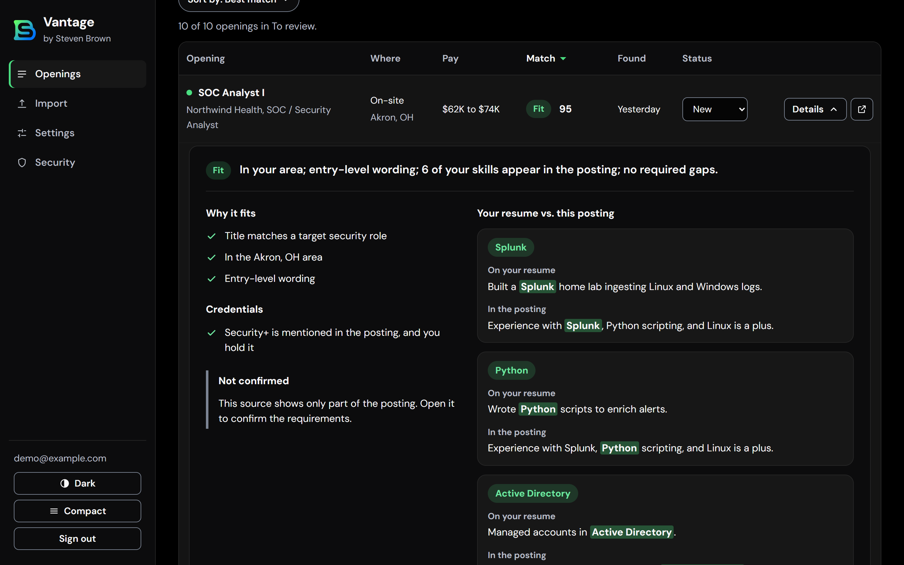
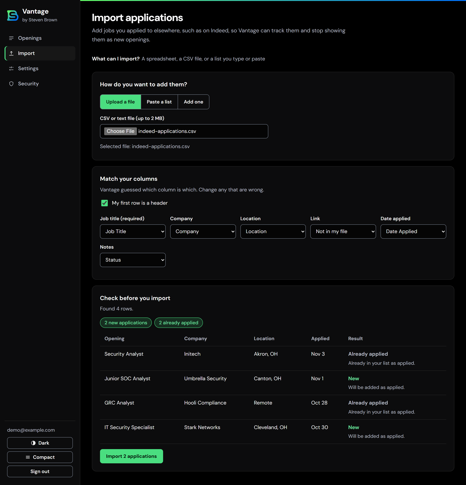
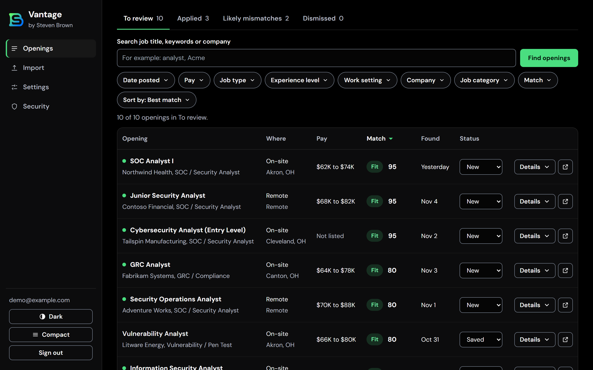
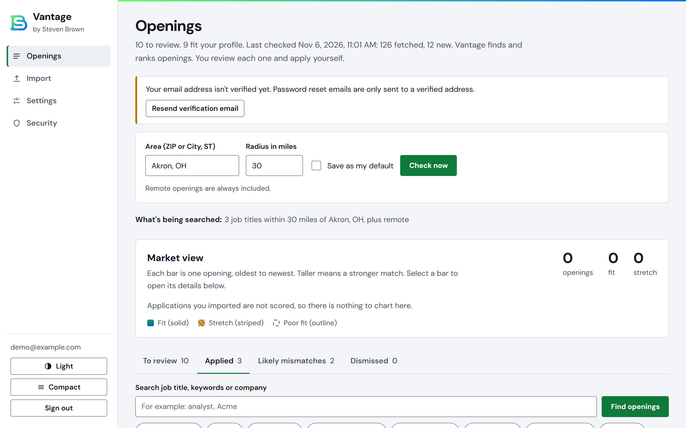
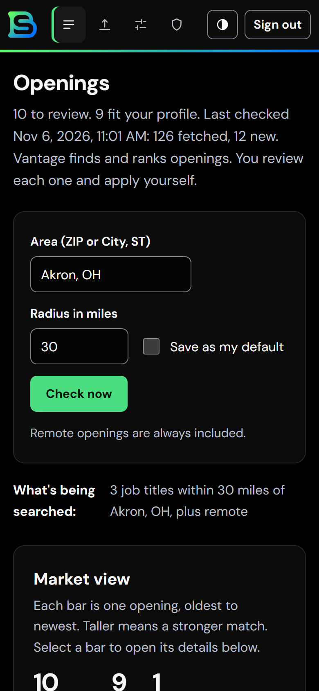
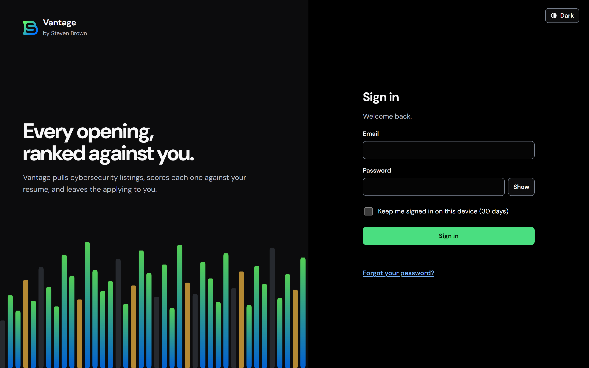

<div align="center">


# Vantage

**Every opening, ranked against you.**

A private job-search console that finds entry-level cybersecurity openings near Akron, OH (or remote), scores each one against your resume, and shows its evidence. You review. You apply.


<picture>
  <source media="(prefers-color-scheme: light)" srcset="docs/screenshots/dashboard-light.png">
  
</picture>

</div>

---

## Why I built it

Job boards show hundreds of listings and no reasoning. I wanted a tool that answers three questions for each opening: **does it fit me, why, and what is the posting not telling me?** It never applies for me and never scrapes LinkedIn or Indeed. It reads a free, terms-compliant source, ranks what it finds with plain rules, and leaves the decision to me.

## What it does

| | |
|---|---|
| **Finds** | Pulls openings from the Adzuna API, plus optional Greenhouse and Lever employer feeds. Searches a chosen radius around a ZIP or city, and always includes remote. |
| **Ranks** | Scores each posting 0 to 100 from the title, location, seniority wording, years asked for, required certifications and the skills on your resume. |
| **Explains** | A "Why it fits" panel pairs each matched skill with the line on your resume and the sentence in the posting, with the words highlighted. Anything the posting does not say is shown as "Not confirmed" instead of guessed. |
| **Filters** | Indeed-style chips: date posted, pay, job type, experience level, work setting, company, category and match. Each option shows its count. |
| **Imports** | Add jobs you applied to elsewhere by CSV, pasted list or a single form. A preview shows what is new and what is a duplicate before anything is saved. |
| **Tracks** | Status per opening (new, saved, applied, dismissed), an Applied tab with dates, and an optional daily email digest. |

<table>
  <tr>
    <td width="50%"><br><sub><b>Evidence, not guesses.</b> Resume line and posting text side by side.</sub></td>
    <td width="50%"><br><sub><b>Import what you applied to elsewhere.</b> Preview before saving.</sub></td>
  </tr>
  <tr>
    <td><br><sub><b>Indeed-style filters</b> over a sortable, ranked table.</sub></td>
    <td><br><sub><b>Light and dark themes</b>, plus a compact row density.</sub></td>
  </tr>
</table>

## Built with care

- **Enterprise-style sign-in for one owner.** Scrypt passwords, authenticator-app 2FA with recovery codes, email verification and reset, device list with revoke, lockout, and an audit log. No library: the core is small, framework-free and unit tested. See [SECURITY.md](SECURITY.md).
- **Evidence-only explanations.** Every claim must cite text from your resume and the posting. The matching rules are pure functions in [`src/lib/match.ts`](src/lib/match.ts), so they are deterministic and testable.
- **Local resume parsing.** A rule-based engine reads PDF, DOCX or text. Nothing is sent to a model or third party, and the file itself is not kept. See [PRIVACY.md](docs/PRIVACY.md).
- **Accessible.** Contrast-measured color tokens, keyboard-operable filters, patterns as well as color in charts, and axe-core scans with zero violations on the pages checked in light and dark.
- **Hardened data layer.** Atomic writes with backups, corrupt files quarantined rather than deleted, serialized saves, and a guard so two checks cannot run at once and burn API quota.
- **Tested.** 392 automated tests, including fuzzed import input, route abuse, concurrent writes and a 3,000-opening performance check. What was and was not tested is listed honestly in [TESTING.md](docs/TESTING.md).

<details>
<summary><b>Phone layout and sign-in screen</b></summary>
<br>
<table>
  <tr>
    <td></td>
    <td></td>
  </tr>
</table>
</details>

## Status

Vantage is a private, single-user project. This repository is published to show the design and engineering, not as something to install.

## How it works

```
Adzuna / Greenhouse / Lever  ->  validate (zod)  ->  match (pure rules)  ->  de-duplicate
        ->  JSON store (atomic, backed up)  ->  dashboard  ->  optional email digest
```

One Next.js process, no extra services. Sources sit behind a small `JobSource` interface, and storage sits behind `withStore` so it can be swapped for a database. Details and the reasoning behind each choice are in [ARCHITECTURE.md](docs/ARCHITECTURE.md).

## Boundaries

- Finds and ranks only. **No auto-apply, no scraping of LinkedIn or Indeed.**
- Adzuna returns truncated descriptions, so year and certification detection there is best-effort. Treat scores as a triage aid and read the posting.
- Single owner account by design.

## Documentation

| | |
|---|---|
| [Features](docs/FEATURES.md) | Filters, explanations, importing, appearance and matching limits |
| [Architecture](docs/ARCHITECTURE.md) | Data flow and design decisions |
| [Security](SECURITY.md) | Authentication, controls and known limits |
| [Privacy](docs/PRIVACY.md) | What is stored and what leaves the machine |
| [Testing](docs/TESTING.md) | What was verified and what was not |
| [Changelog](CHANGELOG.md) | Release history |

## About

Built by **Steven Brown**, Aquila Digital. [stevenrbrown.org](https://www.stevenrbrown.org/)

All rights reserved. The source is published for viewing; it is not licensed for reuse.
